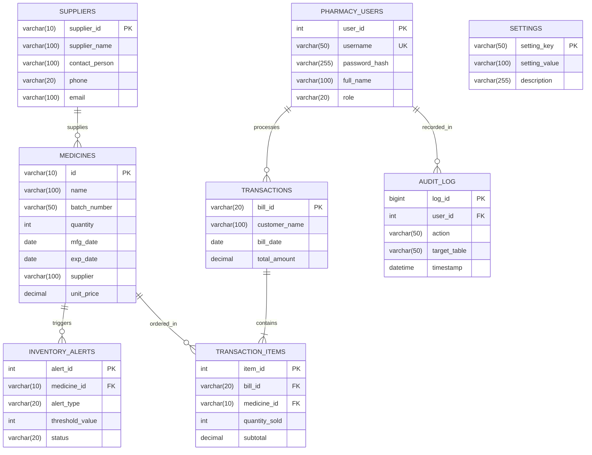

# Database Entity-Relationship (ER) Diagram — Pharmacy Inventory & Billing System

This document outlines the relational database architecture and Entity-Relationship (ER) specifications for the **Pharmacy Inventory & Billing Management System** (`pharmacy_db`).

Both high-resolution vector and raster image files have been generated in this directory:
- **Vector Graphic (SVG)**: [`database_er_diagram.svg`](database_er_diagram.svg) (Open in any web browser or embed directly into Microsoft Word without quality loss)
- **High-Resolution Image (PNG)**: [`database_er_diagram.png`](database_er_diagram.png) (300 DPI high-res image suitable for reports and presentations)

---

## Mermaid ER Diagram

---

## Entity & Relationship Specifications

### 1. Active MySQL Tables (`setup_pharmacy_db.sql`)

| Table Name | Primary Key | Foreign Keys | Description |
|---|---|---|---|
| **`medicines`** | `id VARCHAR(10)` | None | Stores pharmaceutical inventory batches, stock quantities, manufacturing and expiration dates, and pricing. |
| **`transactions`** | `bill_id VARCHAR(20)` | None | Stores billing records, customer name, sale date, and total invoice amount. |
| **`transaction_items`** | `item_id INT AUTO_INCREMENT` | `bill_id` &rarr; `transactions(bill_id)` `medicine_id` &rarr; `medicines(id)` | Bridge / line-item entity recording each medicine, quantity purchased, and subtotal per transaction. |

### 2. Relational Cardinalities
- **`transactions` (1) to `transaction_items` (N)**: One invoice contains one or more line items (`ON DELETE CASCADE`).
- **`medicines` (1) to `transaction_items` (N)**: A medicine batch can be referenced across multiple sales.
- **`medicines` (1) to `inventory_alerts` (N)**: Automatic threshold warnings triggered when stock &le; 10 units or expiring within 30 days.
- **`suppliers` (1) to `medicines` (N)**: Pharmaceutical manufacturers/distributors supplying medication batches.
