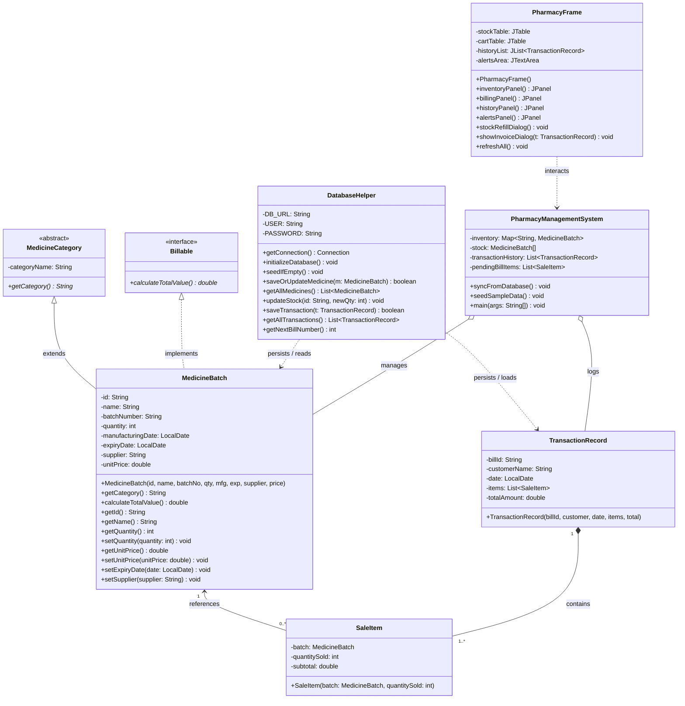

# UML Class Diagram — Pharmacy Inventory & Billing Management System

This document describes the UML Class Diagram structure for the Pharmacy Management System (`project.java`).

Both high-resolution vector and raster image files have been generated in this directory:
- **Vector (SVG)**: [`class_diagram.svg`](class_diagram.svg) (Open in any browser or embed directly into Microsoft Word)
- **High-Resolution Image (PNG)**: [`class_diagram.png`](class_diagram.png) (300 DPI high-res image)

---

## Mermaid UML Class Diagram

---

## Diagram Relationships Explanation

1. **Generalization (`extends`)**:
   - `MedicineBatch` inherits from the abstract base class `MedicineCategory` and overrides `getCategory()`.
2. **Realization (`implements`)**:
   - `MedicineBatch` implements the `Billable` interface and overrides `calculateTotalValue()`.
3. **Association**:
   - `SaleItem` holds a reference to the `MedicineBatch` sold.
4. **Composition / Aggregation**:
   - `TransactionRecord` is composed of multiple `SaleItem` objects (`List<SaleItem>`), representing the items in a bill.
5. **Dependency / Persistence**:
   - `DatabaseHelper` handles CRUD persistence for `MedicineBatch` (table `medicines`) and `TransactionRecord` (tables `transactions` and `transaction_items`).
6. **GUI Interaction**:
   - `PharmacyFrame` (inheriting from `JFrame`) renders the presentation layer and delegates data operations to `PharmacyManagementSystem` and `DatabaseHelper`.
